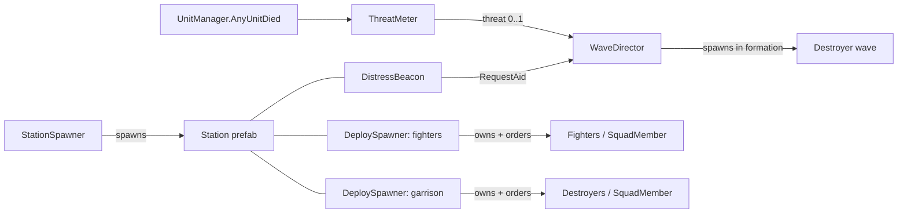
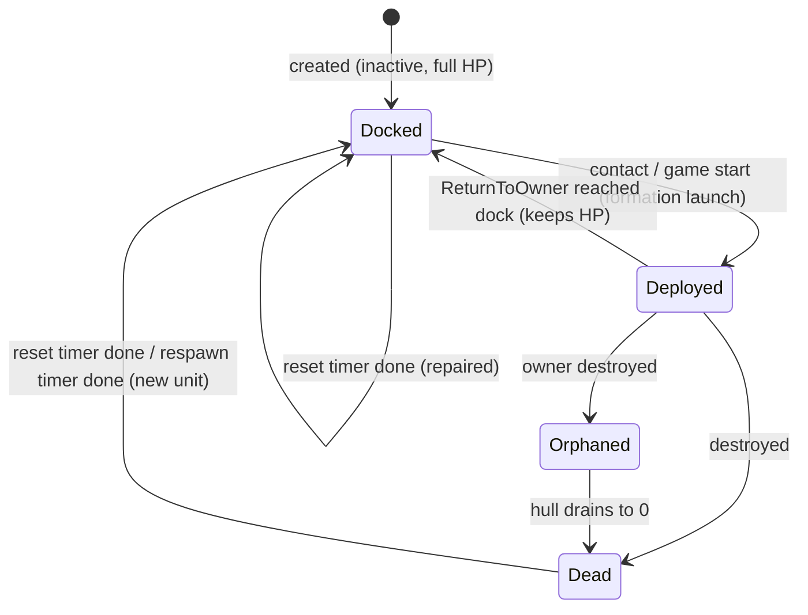

# Enemy Spawning — Design & Roadmap

**Goal:** the enemy faction should feel organised. Stations raise the alarm, reinforcements arrive in
formation, carriers and stations launch and recall their own squads, and losses get replaced over time.

Spawning is split into three systems that share one ownership model.

| # | System | Scripts | Spawns | Triggered by |
|---|--------|---------|--------|--------------|
| 1 | **Station Spawner** | `StationSpawner` | Stations | Game start (run lifetime, game-over when all are gone) |
| 2 | **Wave Director** | `WaveDirector`, `DistressBeacon`, `ThreatMeter`, `WaveDefinition` | **Destroyers only** | A station's sensor spots the player → distress call → timer |
| 3 | **Deploy Spawner** | `DeploySpawner`, `SquadMember`, `AIReturnToOwnerBehaviour` | Any owned unit (fighters, garrison destroyers, later carriers' squads) | Game start or the owner's sensor contact |

Shared helpers: `FormationUtility` (formation offsets), `UnitSetup` (assign home/target, NavMesh placement, teleport).



---

## Core rule: ownership & orders

* Every deployable unit has a `SquadMember` and belongs to exactly **one** `DeploySpawner`, its owner.
* A unit only accepts orders (`Patrol`, `Engage`, `ReturnToOwner`) from its owner (`ReceiveOrder` checks the issuer).
* **Fighters never exist on their own.** `WaveDirector` refuses prefabs with a `FighterManager`.
* **Owner destroyed → orphaned.** Units keep their last order and take `orphanDamagePerTick` every
  `orphanTickInterval` until they die (self-destruct). Docked units are destroyed with the hangar.
* Deployed units live under a scene container (`DeployedUnits`), **not** under the owner. A dead owner
  is `SetActive(false)`, which would otherwise switch off every child unit instead of orphaning it.

---

## 1. Station Spawner (done)

Already split out of `EnemySpawner`. It places `stationCount` stations at a minimum spacing, tracks how
many are alive, and asks `GameManager` for game over when the last one dies.

Next steps:
* Put `DistressBeacon` + `DeploySpawner`(s) on the **station prefab**, so every spawned station sets itself up.
* Later: an event such as `StationSpawned(Transform)` if other systems need to react (minimap, UI).

---

## 2. Wave Director (destroyer reinforcements)

### Flow
1. The station's `AIDetector` acquires the player → `DistressBeacon` → `WaveDirector.RequestAid(beacon, player)`.
2. The request is rejected if this station already has a pending wave or is on `stationCooldown`.
3. Threat goes up (`ThreatMeter.OnStationAlerted`). The timer is set to `Lerp(waveDelayAtLowThreat, waveDelayAtHighThreat, threat)`.
   The `WaveIncoming(beacon, seconds)` event fires (hook a UI warning to it).
4. When the timer runs out, a `WaveDefinition` is picked (weighted random filtered by `minThreat`, or sequential),
   capped by `maxAliveWaveShips`, and spawned **in formation, facing the player**.
5. Wave ships get the station as their home (patrol + reach) and the player as their target.
6. The station dies → its pending wave is cancelled.

### Threat → placement
```
playerPos = playerPos clamped to maxDistanceFromStation around the calling station
centre = Lerp(stationPos, playerPos, threat * maxApproach)
spread = Lerp(spreadAtLowThreat, spreadAtHighThreat, threat)
anchor = centre + random point in circle(spread)
anchor = kept between minDistanceFromStation (clear of the hull) and maxDistanceFromStation
if distance(anchor, player) < minDistanceFromPlayer: push anchor out to minDistanceFromPlayer
```
| Threat | Timer | Where the wave appears |
|--------|-------|------------------------|
| 0.0 | slow (30 s) | Around the station, wide random spread |
| 0.5 | medium | Halfway to the player, moderate spread |
| 1.0 | fast (10 s) | Right next to the player (≥ `minDistanceFromPlayer`), tight spread |

### Threat sources (`ThreatMeter`)
Station alert +10, fighter killed +1, ship killed +4, station destroyed +25. It decays 0.5/s after 10 s
without a new threat event. Orphans burning out and the player's own death don't count. Every value is tunable.

### Constraint to keep in mind
Destroyers have the `WithinParentStationReach` leash (`stationOutOfReach` = 300 on the prefab). Keep
`station sensor radius (105) + spreadAtLowThreat` **below** that, or a wave spawned far from its station
will immediately turn back home instead of attacking.

---

## 3. Deploy Spawner (owned squads)

A component you can drop on **any** station or ship. It has a fixed set of slots (`maxSquads × unitsPerSquad`),
so it can **never** exceed its maximum. Each slot holds one unit and its state.



### Settings
| Setting | Options | Meaning |
|---------|---------|---------|
| `trigger` | `OnGameStart` / `OnSensorContact` | When the first launch happens |
| `recallMode` | `DockAndStore` / `ReturnAndPatrol` | What deployed units do when the player leaves sensor range |
| `replenishMode` | `ResetWhenIdle` / `ContinuousRespawn` | How losses and damage are restored |
| `resetTime` | seconds | `ResetWhenIdle`: starts only when **no** unit is deployed (all docked or dead) |
| `respawnTime` | seconds | `ContinuousRespawn`: per dead unit, always running |

### Presets for your examples
| Use case | trigger | recallMode | replenishMode |
|----------|---------|-----------|---------------|
| Station fighters | OnSensorContact | DockAndStore | ResetWhenIdle |
| Station destroyer garrison | OnGameStart | ReturnAndPatrol | ContinuousRespawn |
| Carrier fighters (later) | OnSensorContact (carrier's sensor) | DockAndStore | ResetWhenIdle |

### Squad flight (`SquadFlocking`)
The formation is only exact at launch. After that, fighters fly as a loose boid flock: `FollowPlannedPath`
passes its path direction to `SquadFlocking` (on the Motor), which blends in:

| Force | Effect |
|-------|--------|
| Separation | push away from squadmates closer than `separationRadius` |
| Cohesion / alignment | drift towards the squad's centre and heading |
| Formation | sideways pull towards the slot behind the leader; the throttle holds the slot along the heading |

The leader (first deployed slot) flies its own path at `leaderThrottle`. On patrol, wingmen follow the
leader's route (a point just ahead of their slot) instead of their own patrol points. Two weight sets:
`formationWeights` (patrol/return) and `engagedWeights` (formation mostly released for strafing runs).
Because squadmates push each other off course, a strafing leg also ends when the fighter **flies past**
its goal, or after `maxLegTime`.

### Memory of health
Docked units aren't destroyed. They're deactivated and keep their `UnitManager` state, so the same
damaged fighters launch again. If the player comes back **before** the reset finishes, the timer is
cancelled and the survivors relaunch as they are. Dead slots stay empty until a reset/respawn.

---

## Behaviour tree changes (not done yet — editor work)

`EnemyAIRunner` finds conditions by **property name** via reflection, so `SquadMember` can be used directly:

**Fighter tree** (`BehaviourTreeDataFighter`), with a new branch at the **top** of the root selector:
```
root (Selector)
├─ Return (Sequence)                      ← NEW, must be first
│   ├─ Condition  SquadMember.OrderedToReturn
│   └─ Action     ReturnToOwner
├─ FighterPursuit (Sequence)              (existing)
└─ FighterPatrol                          (existing)
```
Add the same `Return` branch to the destroyer tree if garrison destroyers should ever dock.

Each unit prefab needs `SquadMember` and `AIReturnToOwnerBehaviour` on the **root** object, the same object as
`AIContext`, because behaviours are looked up with `GetComponents<AIBehavior>()` there. `SquadMember` is
auto-added at runtime if it's missing, but adding it to the prefab lets you tune the orphan drain.

> A unit **without** `SquadMember` (e.g. spawned by the old `EnemySpawner`) will log
> "Condition not Found" for that tree node, and the node then evaluates as `false`. It won't crash.

---

## Roadmap

> **Setup tool:** `Assets/Editor/EnemySpawningSetup.cs` adds Tools > Enemy Spawning > Run Full Setup. It configures the
> three EnemyAI prefabs, adds the Return branch to the fighter tree, creates `Assets/Data/Waves/*.asset` and wires
> `GameScene`. It can be re-run safely. Ship prefabs keep the root still and move the `Motor` child, so all spawning
> code looks up `UnitManager`/`NavMeshAgent` in children and teleports by resetting `Motor` to local zero.

| Phase | Work | Done when | Status |
|-------|------|-----------|--------|
| 0 | Split station spawning out of `EnemySpawner` | Stations spawn from `StationSpawner` | ✅ done |
| 1 | Foundations: sensor events, `UnitManager.Died`, re-enable-safe AI, formations, `UnitSetup` | Compiles; current game unchanged | ✅ code done |
| 2 | **Fighters via DeploySpawner**: add `DeploySpawner` to the station prefab (fighter preset), add `SquadMember` + `AIReturnToOwnerBehaviour` to the fighter prefab, add the Return branch to the fighter tree, set `EnemySpawner.spawnFighters = false` | Fighters launch on contact, dock on exit, relaunch damaged, refill after reset | setup automated by `Tools > Enemy Spawning > Run Full Setup`; needs playtest |
| 3 | **Garrison destroyers via DeploySpawner** (garrison preset), set `EnemySpawner.spawnDestroyers = false` | Destroyers patrol from the start and respawn after `respawnTime` | setup automated; needs playtest |
| 4 | **Waves**: add `WaveDirector` + `ThreatMeter` to the scene, `DistressBeacon` to the station prefab, create 2–4 `WaveDefinition` assets | Wave arrives after the timer, in formation; position follows threat | setup automated; needs playtest |
| 5 | Orphans: kill a station with fighters out | Fighters finish their order, drain, explode | code done, playtest |
| 6 | Remove `EnemySpawner` and the commented-out `FighterSpawner.cs` | Nothing references them | todo |
| 7 | Polish: UI warning on `WaveIncoming`, threat meter UI, launch/dock VFX, formation keeping in flight | — | todo |
| 8 | Carriers: carrier prefab with its own `DeploySpawner` | Carrier launches and recalls fighters on its own sensor | todo |

---

## Tips & pitfalls

* **Dead units are only deactivated, never destroyed** (`UnitManager.DeathCoroutine` → `SetActive(false)`).
  `EnemySpawner.CleanupDeadShips` removes `null`s, so its `aliveDestroyers` list never shrinks and the
  destroyer cap fills up for good. The new code checks `IsDead` instead. In the long run, consider
  destroying dead units, or pooling them on purpose.
* **Coroutines stop when an object is disabled.** That's why `AIDetector` now starts its loop in `OnEnable`
  and the patrol behaviours reset `isWaiting` in `OnDisable`. Check any new behaviour for the same issue
  before it's used on dockable units.
* **`AIDetector` used `Vector2.Distance`** on an XZ-plane game, which ignores Z. It now uses a flat XZ
  distance, so "player left the sensor range" fires correctly. Retune `viewRadius` values if sensors
  suddenly feel shorter.
* **Formation keeping in flight** isn't implemented: squads *spawn* in formation, then each AI flies on its
  own. Next step: give followers the leader's position plus their formation offset as their goal while
  patrolling/returning.
* **Debugging:** select a `DeploySpawner` to see its launch rings. Expose `DeployedCount`, `DockedCount`,
  `ResetTimeRemaining` and `ThreatMeter.Threat` in a small debug overlay; it makes tuning much faster.
* Tune in this order: sensor radius → threat values → wave timers → placement spreads.

## Open questions
1. Should a pending wave still arrive if the player escapes first? (`cancelIfTargetLost`, default: it still arrives.)
2. Should wave destroyers stay as permanent defenders, or leave/despawn after a while?
3. Should docked units repair slowly over time, or only all at once when the reset finishes? (Currently all at once.)
4. Should threat scale wave **size** too, or only timing and placement? (Currently `minThreat` only unlocks bigger waves.)

---

## 4. Formations, doctrine & sub-light

### Doctrine (`EnemyDoctrine` asset)
`aggression = threat + (1 - discipline) * indisciplineAggression`. Aggression ≥ `advanceAggression` → **Advance**
(the leader leads the formation at the player). Aggression ≥ `breakAggression` **and** discipline ≤
`maxBreakDiscipline` → **Break** (the outermost wingmen leave formation to engage; never the leader).
Otherwise **Hold**. Swap the asset per difficulty/mission (on `StationDefense` and `WaveDirector`); empty = defaults.

### Station garrison (`StationDefense` on the station)
The garrison `DeploySpawner` still owns, launches and respawns the destroyers; `StationDefense` gives them
`FormationMember` slots, and the destroyer tree's **Formation** branch (`AIHoldFormationBehaviour` + `Shoot`) holds them.

| Situation | Formation |
|-----------|-----------|
| Never alerted | Even ring (`idleRadius`), ships facing outwards |
| Player in sensor range | Arc (`alertRadius`, `arcAngle`) on the player's side, facing the player; Advance/Break per doctrine |
| Advancing | Station keeps tracking the player up to `maxAdvanceDistance` beyond its sensor range |
| Player gone | Arc stays facing where the player left → the back of the station is open |
| Another station alerted (`DistressBeacon.AnyAlert`) | A previously alerted, idle station swings its arc towards that station |

### Sub-light (`SubLightDrive`, next to `ShipMover`)
`Idle → Charging → Cruising → Exiting → Idle`. Charging: no thrust, turning or weapons; every hit removes
charge (`chargeLostPerDamage`, at least `minChargeLostPerHit`). Cruising: straight line at `cruiseSpeed`; drops out
on request, when the planned distance is covered, or when an obstacle is within braking distance (ships that are
themselves cruising don't count). Player: **Left Shift** = charge, press again = abort / drop out.
It also drops out in time to stop `SubLightClearance` short of a hostile station (150) or destroyer (80) **ahead
and in its path**; units behind or that it will pass wide of are ignored, so jumping away from a fight works.
`obstacleMask` must never include the NavMesh ground plane (ships fly at its height). `PlayerHUD` shows the
charge, why the drive last dropped out, and the hull bar.

### Wave fleets (`WaveFleet`, one per wave)
* **Combat** (target within `engageDistance`): close in formation to `engageStandoff`; doctrine decides breakers.
* **Travel** (further): NavMesh route → first straight leg (≥ `minJumpDistance`) → **form up** → **align** →
  **jump** (`Simultaneous` or `FrontFirst` with `jumpStagger`) → drop out at leg end or within `dropOutRange` →
  re-plan. Every turn means dropping out, turning and jumping again.
* **Intel**: a target in sub-light can't be tracked. The wave flies to where it was last seen and gets a fresh
  position when the target drops out or any station spots it (`WaveDirector.RequestAid` → `ReportSightingToAll`).
